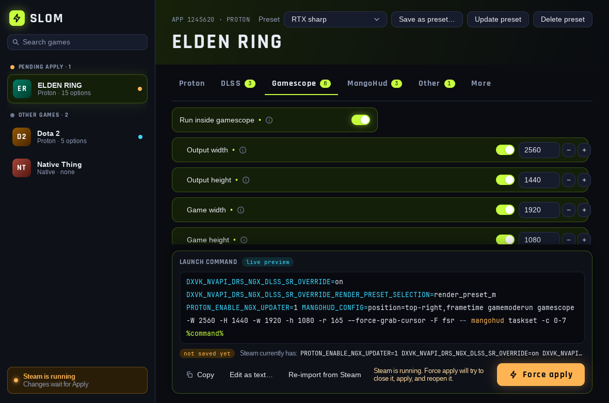

# slom

Set Steam launch options without memorizing them.

Pick a game, flip switches for Proton, DLSS, gamescope, MangoHud and GameMode, and see the
whole command line as you go. Hover any option for a plain-English explanation. slom writes
the result into Steam's launch options for you.



## Use it

```sh
go build -o slom ./cmd/slom
./slom
```

Needs Go 1.27+ and Linux. Close Steam to apply, or use Force apply and slom closes and reopens it for you.
slom backs up `localconfig.vdf` before every change.

- **Presets**: save a setup like "Native 1440p 165Hz" once and use it on many games.
- **Imports** what is already in Steam; anything it doesn't know is kept as-is.
- **Copy** the line instead, if you'd rather paste it into Steam yourself.

Built with [MyGo](https://github.com/egoist/mygo). Working on it with an AI agent? Start at
[AGENTS.md](AGENTS.md).
